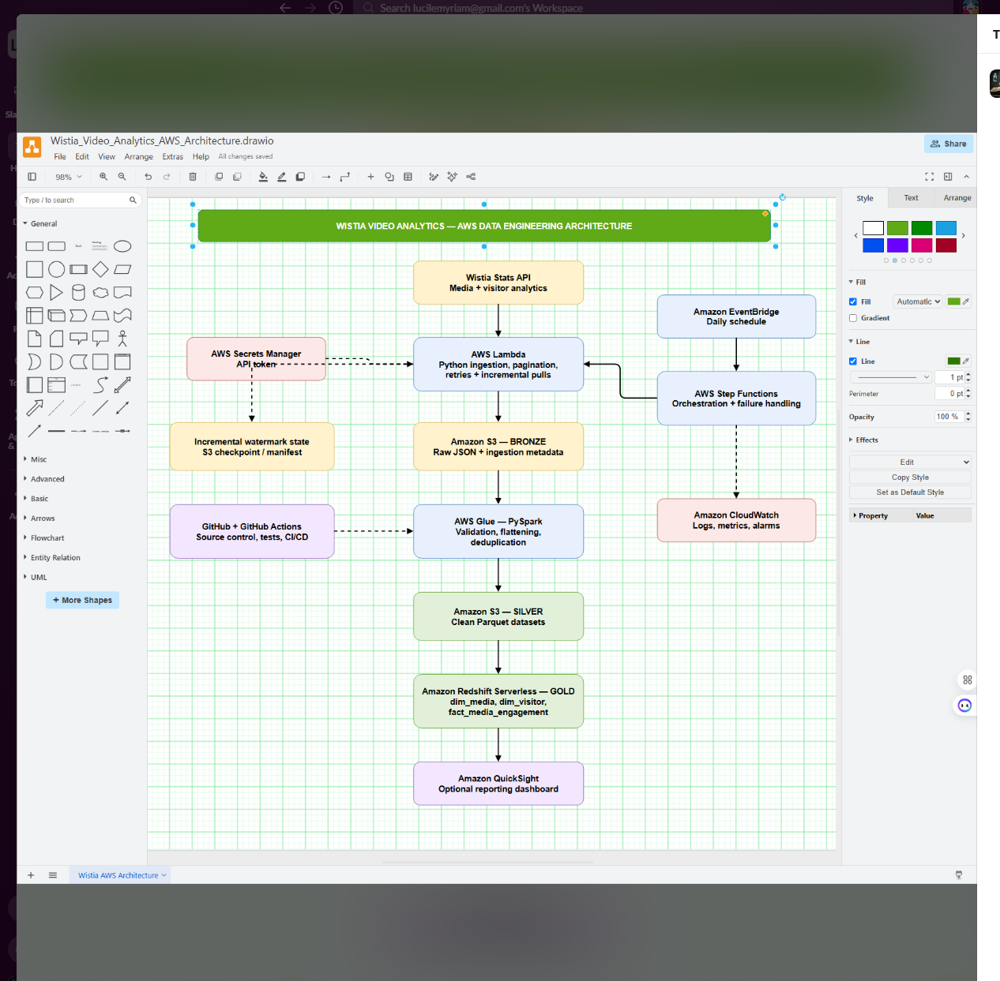
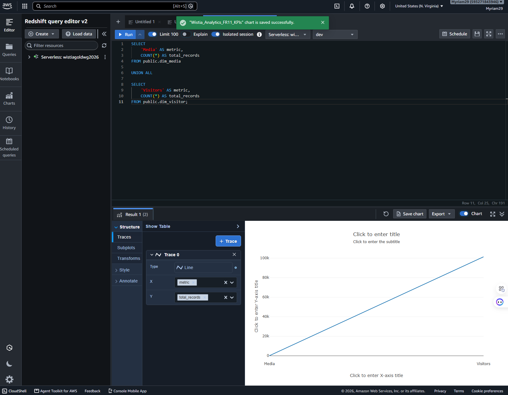

# Wistia Video Analytics — AWS Data Engineering Project

## Business objective
Ingest Wistia media- and visitor-level analytics to support video engagement reporting for marketing.

## Architecture
Wistia Stats API → AWS Lambda (Python) → S3 Bronze → AWS Glue (PySpark) → S3 Silver (Parquet) → Redshift Serverless (Gold). AWS Secrets Manager stores the API token. Step Functions/EventBridge orchestrate scheduled runs; CloudWatch supports observability.

The editable source is [`architecture/Wistia_Video_Analytics_AWS_Architecture.drawio`](architecture/Wistia_Video_Analytics_AWS_Architecture.drawio).

## FR11: Analytics chart

Chart SQL: [`sql/fr11_kpis.sql`](sql/fr11_kpis.sql). The snapshot showed 2 media records and 101,289 visitor records. This is a Redshift Query Editor v2 chart, **not** a QuickSight dashboard.

## Data model
- `dim_media`: media metadata
- `dim_visitor`: visitor dimension
- `fact_media_engagement`: intended engagement facts

**Current limitation:** the latest verification showed zero rows in both engagement fact tables. Redshift `COPY` from Silver Parquet failed because of incompatible Parquet column types. Do not treat FR10 fact loading as completed.

## Repository layout
- `architecture/`: approved design source and screenshot
- `dashboard/`: saved chart screenshot
- `lambda/`: local Lambda source candidates; identify which matches deployed code
- `glue/`: placeholder awaiting actual deployed PySpark script
- `sql/`: KPI and row-count validation queries; add actual Redshift DDL
- `.github/workflows/validate.yml`: automated syntax and file-presence checks (not AWS deployment)
- `docs/setup.md`: setup and verification steps
- `docs/requirements_status.md`: FR1–FR12 status and gaps

## How to reproduce
See [`docs/setup.md`](docs/setup.md). Never commit API tokens, AWS access keys, raw visitor IP data, or sensitive logs.

## Known decisions and tradeoffs
- AWS-only stack; Python ingestion and PySpark transformation; no dbt.
- The requirements PDF says Basic Auth but its sample uses Bearer. The tested integration uses Bearer; SME clarification is needed.
- Redshift Query Editor chart is used for optional FR11 instead of QuickSight.
- Seven consecutive production days and working deployment CI/CD need separate evidence.

## Submission checklist
- [ ] Identify and keep only the exact deployed Lambda code
- [ ] Export deployed Glue PySpark script(s)
- [ ] Add complete Redshift DDL and verified load SQL
- [ ] Resolve or explicitly document fact-table Parquet mismatch
- [ ] Add actual Step Functions definition, EventBridge schedule, and operational evidence
- [ ] Provide seven consecutive days of production run evidence
- [ ] Verify GitHub Actions checks pass and document deployment process
- [ ] Add recorded walkthrough link if required by instructor
